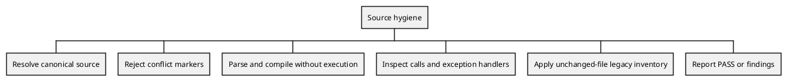

# Clean-code conventions

Consistent interfaces, isolated tests and executable checks reduce the context
needed to extend a utility. This guide applies to new code and to modules being
refactored. Existing public interfaces are preserved unless the behavior change
is part of the task.

## Source and test layout

- Package code belongs under `src/assetutilities/<area>/`.
- Workflow defaults belong under `src/assetutilities/base_configs/` and travel
  with the installed package. Tests use their own inputs rather than editing
  these defaults.
- Unit tests belong under `tests/unit/`; workflow tests belong under
  `tests/modules/<basename>/`. Inputs and expected results stay with the test,
  independently of `docs/`, external checkouts and a caller's working directory.
- Resolve read-only fixtures relative to `__file__`. Put generated outputs in
  pytest's `tmp_path`, never beside tracked inputs. Do not depend on test order.
- Test a module's public behavior before refactoring it. Expected values come
  from a cited example or an independent calculation in the test docstring.
- Reproduce a basename's tests with `python -m pytest tests/modules/<basename>`;
  a separate batch file is unnecessary for each basename.

## Naming, imports and interfaces

Use `snake_case` for functions and variables, `PascalCase` for classes and
`UPPER_SNAKE_CASE` for constants. Keep standard-library, third-party and package
imports in separate groups. Prefer absolute package imports across module
boundaries and explicit imports over wildcards.

Public callables use Google-style docstrings with a summary and, where needed,
`Args`, `Returns` and `Raises`. Describe input units, output shape, mutations,
exceptions and the method's source. Comments explain a non-obvious constraint or
decision; they do not repeat each statement. A mapping suits named result
metadata, but existing scalar, tuple and object contracts are preserved.

Functions have one responsibility. There is no arbitrary line-count requirement
and no repository-wide conversion of return types in this change.

## Logging and errors

Use the module's established logger for diagnostic output. Common utilities use
Loguru; existing developer tools also use standard-library logging. Avoid
configuring global logging handlers from an imported library module. Messages
use `PASS`/`FAIL` for checks and `START`/`STOP` for process status.

Raise a specific exception such as `ValueError` for invalid input. Catch the
expected exception type; a bare `except:` also catches termination and interrupt
signals. Re-raise unexpected failures rather than treating them as an empty
result. An engineering check with missing evidence is `NOT_EVALUATED`, not a
passing result or a numeric zero.

## Executable source policy

Run the existing gate:

```sh
bash scripts/hygiene/check-source-hygiene.sh
```

The gate retains the routing, backup and tracked-cache checks. It also invokes
`scripts/hygiene/check_python_style.py`, using `PYTHON` when set, otherwise
`python3`. The Python checker requires only the standard library and imports no
application module. Its default root comes from the script's location, so it
works in a dedicated worktree. An explicit `--root` supports disposable tests.

| Rule | Checked surface | Passing criterion |
| --- | --- | --- |
| `PY-PRINT` | Python in `src/assetutilities/` | No direct call spelled `print(...)`, except unchanged legacy files below |
| `PY-EXCEPT` | Same Python source | Every exception handler has a type, except unchanged legacy files below |
| `SYNTAX` | Same Python source | Parsing and compilation succeed; source is never executed |
| `MERGE` | Package Python, YAML and TOML, plus root `pyproject.toml` | No standard Git conflict-marker lines |
| `SOURCE` | Canonical package tree | Source exists, can be read and contains no symbolic links |
| `BASELINE` | `config/quality/python-hygiene-baseline.json` | Every entry identifies an unchanged legacy Python file that still has style findings |

Table 1. The gate's scope and criteria are explicit; scripts and examples are outside the package scan.

The legacy inventory records SHA-256 digests after converting CRLF line endings
to LF; every other byte is preserved. Each initial entry was compared with the
existing base revision before being recorded. Unchanged
legacy files may retain their existing direct prints and bare handlers. Any edit
invalidates that file's exception: clean its findings and remove its entry.
Missing, malformed, deleted-file or unnecessary entries fail. Syntax and conflict
markers always fail, even when a file's digest matches. New exceptions require
explicit review; refreshing a digest to hide newly introduced debt is prohibited.

This is a syntactic policy, not name resolution: a locally defined callable
named `print` is also reported, while aliases and attribute calls are not
identified as builtin print calls. It does not enforce all naming, typing,
logging, documentation or engineering-method requirements. The baseline does
not establish that legacy code is correct.

The AST method follows the Python language documentation, version 3.9:
[`Call` and `ExceptHandler`](https://docs.python.org/3.9/library/ast.html)
identify calls and typed handlers. The
[`ast.parse` warning](https://docs.python.org/3.9/library/ast.html#ast.parse)
explains why an additional compilation step is needed for contextual syntax
errors. Counts in the worked example are independent hand counts; no engineering
constant or physical acceptance limit is introduced.

## Documentation flow and worked example



The high-level flow is complemented by method docstrings in the checker.
The [worked example](examples/clean-code-hygiene.html) contains the inputs,
hand calculation, commands and expected answer. Its executable counterpart is
`examples/hygiene/clean_code.py`; it retains both input trees and the results in
a caller-selected unused output directory.

## Review checklist

- Add a failing behavior test before changing implementation; run it again
  after the change and run the affected module's existing tests.
- Keep fixture inputs local to the test. Clear inherited Git bindings before
  running repository-aware helpers against disposable trees.
- Run Ruff's checks and formatting checks on changed Python files.
- Run the source-hygiene and repository-structure gates.
- Review source-digest legacy exceptions rather than regenerating them blindly.
- Check scripts for failure propagation: a failed subprocess is not evidence
  that a forbidden-file query returned no matches.
- Check that enforcement fixtures and implementation files pass their own
  configured scope; quoted examples must not accidentally block the gate.
- Keep any broader basename refactoring, stale-test removal, automatic pull
  request tooling and output-configuration redesign as separate tested work.
